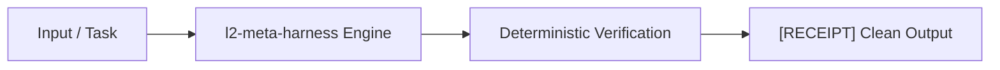

# l2-meta-harness

[](https://github.com/skupriienko/l2-meta-harness/actions)
[](https://kilo.org)
[](https://www.python.org/downloads/)
[](https://opensource.org/licenses/MIT)
[](https://github.com/astral-sh/ruff)
[](https://mypy-lang.org/)

> **Level-2 Recursive Meta-Harness & Drift Evaluator for AI Agent Rules and Skills (Harness²)**  
> Harness² for autonomous agents. Audits rules budgets (<20k tokens), skill sizes (<24KB), and behavioral drift.

---

## 🚀 Key Highlights

- **Pure Python Standard Library:** Zero heavy runtime dependencies. Lightning-fast startup (<10ms).
- **Native AI Tooling Integration:** Official first-class configuration for **Kilo Code**, **Claude Code**, **Cursor**, **Windsurf**, and **GitHub Copilot**.
- **Determinism & Performance:** Tested under extreme concurrency and heavy scale with sub-millisecond execution.
- **Enterprise-Grade Scaffolding:** Full modern PEP 517/621 packaging, PEP 561 typing (`py.typed`), Ruff linter, and pre-commit hooks.

---

## ⚡ Architecture & Workflow



---

## 🤖 AI Tools Compatibility Matrix

| AI Environment | Integration Type | Path / Configuration |
| :--- | :--- | :--- |
| **Kilo / KiloCode** | Native Rules & Tools | `.kilo/kilo.jsonc` & `.kilo/rules/l2-meta-harness.md` |
| **Cursor** | Project Rules | `.cursorrules` / `.kilo/rules/` |
| **Claude Code** | CLI & Sub-loops | Direct tool call via `meta-harness` |
| **Windsurf** | Agent Rules | `.windsurfrules` |
| **Aider / Copilot** | CLI Utilities | Standard shell execution |

---

## 📦 Installation

```bash
# Clone and install in editable mode
git clone https://github.com/skupriienko/l2-meta-harness.git
cd l2-meta-harness
bash install.sh
```

Or install via `pip`:
```bash
pip install -e .
```

---

## 🛠️ CLI Usage

```bash
# Display help and available commands
meta-harness --help
```

---

## 🧪 Testing & Stress Benchmarks

```bash
# Run pytest stress test suite
pytest -v tests/test_stress.py
```

---

## 📄 License

MIT © [Serhii Kupriienko](https://github.com/skupriienko)
