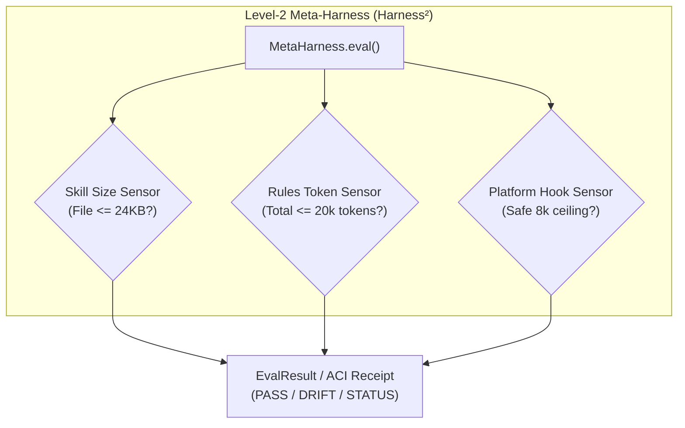

# l2-meta-harness

[](https://github.com/skupriienko/l2-meta-harness/actions)
[](https://kilo.org)
[](https://www.python.org/downloads/)
[](https://opensource.org/licenses/MIT)
[](https://github.com/astral-sh/ruff)
[](https://mypy-lang.org/)

> **Level-2 Recursive Meta-Harness & Drift Evaluator for AI Agent Rules and Skills (Harness²)**  
> Evaluates the test environment itself: audits rules token budgets (<20k tokens), skill size caps (<24KB), and detects cognitive instruction drift.

---

## 🚀 Key Highlights

- **Harness² Recursive Evaluation:** Audits agent instructions, tool caps, and platform constraints to prevent harness decay.
- **Skill Cap Compliance:** Enforces the official [`agentskills.io`](https://agentskills.io) 24KB file ceiling across all skill bundles.
- **Bounded Memory Safety:** Streams large rule files with 500KB chunking to prevent memory exhaustion and runaway regexes.
- **Native AI Tooling Integration:** Official first-class configuration for **Kilo Code**, **Claude Code**, **Cursor**, **Windsurf**, and **GitHub Copilot**.
- **Determinism & Performance:** Benchmarked auditing 100 skills and 50 rules in <0.22s.

---

## ⚡ Architecture & Workflow



---

## 📦 Installation

```bash
# Clone and install in editable mode
git clone https://github.com/skupriienko/l2-meta-harness.git
cd l2-meta-harness
bash install.sh
```

Or install via `pip`:
```bash
pip install -e .
```

---

## 🛠️ CLI Usage

```bash
# Evaluate rules and skills across the current directory
meta-harness .

# Output raw JSON for continuous integration
meta-harness ./agents --json
```

---

## 🐍 Python API

```python
from l2_meta_harness import MetaHarness, EvalResult

harness = MetaHarness(root_dir="./my-agents")
result: EvalResult = harness.eval()

print(f"Status: {result.status}")
print(f"Rules tokens approx: {result.rules_tokens_approx} / {result.rules_budget_max}")
print(f"Oversized skills count: {result.oversized_skills_count}")
for finding in result.findings:
    print(f"  [FINDING] {finding}")
```

---

## 🤖 AI Tools Compatibility Matrix

| AI Environment | Integration Type | Path / Configuration |
| :--- | :--- | :--- |
| **Kilo / KiloCode** | Native Rules & Tools | `.kilo/kilo.jsonc` & `.kilo/rules/l2-meta-harness.md` |
| **Cursor** | Project Rules | `.cursorrules` / `.kilo/rules/` |
| **Claude Code** | CLI & Sub-loops | Direct tool call via `meta-harness` |
| **Windsurf** | Agent Rules | `.windsurfrules` |
| **Aider / Copilot** | CLI Utilities | Standard shell execution |

---

## 🧪 Testing & Stress Benchmarks

```bash
# Run pytest stress test suite (100 skills & 50 rules audited in <0.25s)
pytest -v tests/test_stress.py
```

---

## 📄 License

MIT © [Serhii Kupriienko](https://github.com/skupriienko)
